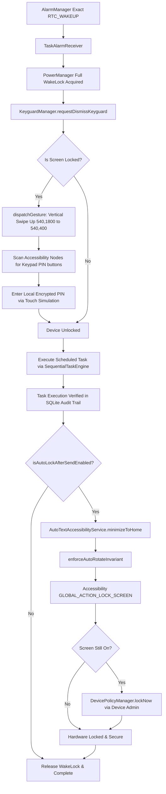

# AutoText Master Technical Blueprint & Architecture Specification

> **The Authoritative Architectural, Algorithmic, and Implementation Manual for AutoText (`com.jmd.autotext`).**  
> *Designed to serve as an exact, complete specification enabling full replication, maintenance, and auditing of the application.*

---

## 1. System Vision & Core Architectural Tenets

AutoText is an enterprise-grade, offline-first Android automation platform engineered for mission-critical, unattended communication dispatch across seven core channels:
1. **Direct SMS (Single & Multi-SIM Slot Support with PDU Calculation)**
2. **Consumer WhatsApp (Direct Send & Chat Automation)**
3. **WhatsApp Business (W4B Direct Send & Catalog/Customer Messaging)**
4. **WhatsApp Status Story Publishing (Media & Text for Personal and Business)**
5. **Direct Native Telephony Calls (Custom Call Duration, Dial Timing & Auto-Hangup)**
6. **WhatsApp VoIP Voice Calls (Automated Call Placement & Active Call Hangup)**
7. **Simulated Fake Incoming Calls (High-Priority Wake Lock, Lockscreen Bypass & Realistic OEM Themes)**
8. **Scheduled Audio Alarms & Reminders (Native Clock App Sync & TTS Voice Announcements)**

### Foundational Principles
- **100% On-Device Sovereignty**: All credentials, contacts, scheduled queues, message templates, device unlocking PINs, and execution audit logs are stored strictly within the local SQLite database (`autotext.db`) and encrypted direct-boot preferences. No analytics SDKs, cloud tracking databases, external APIs, or telemetry services exist within the codebase.
- **Zero Persistent Notification Footprint**: Unlike conventional automation utilities that maintain an ongoing foreground service notification 24/7, AutoText relies on Android's Doze-safe `AlarmManager.setExactAndAllowWhileIdle()` and background WorkManager coroutines. It leaves **zero** sticky banners or icons in the user's status bar when idle.
- **Display Invariant Protection (Strict Portrait Locking & Never Auto-Rotate)**: AutoText strictly enforces a device display invariant ensuring system auto-rotation is never enabled by background tasks or activity launches. All activities are hard-locked to portrait orientation, system quick setting tiles and navigation bar rotation buttons are insulated from automation clicks, and `ACCELEROMETER_ROTATION` is dynamically audited and kept disabled (`0`).
- **Immediate Task Halt & Emergency Stop**: Toggling off the master scheduler or activating Emergency Stop instantly aborts all ongoing tasks, slices long delays into 250ms cancellation polling chunks, drains execution channels, and purges accessibility queues.
- **Full Unattended Automation with Keyguard Auto-Unlock & Auto-Lock Postcondition**: Tasks execute safely even when the phone is locked. The engine wakes the display, dismisses the keyguard, inputs the local AES-GCM encrypted security PIN via touch simulation, executes the task, returns to the home launcher, and locks the hardware screen immediately via Device Admin.
- **100% Modern Kotlin Architecture**: Clean, decoupled, modular architecture adhering strictly to modern Android architecture guidelines, with zero legacy Java, zero deprecated API calls, and zero warnings.
- **Embedded Source Archival**: Using custom Gradle tasks, complete project source files and specifications are bundled directly within the release build (`assets/AUTOTEXT_FEATURES_AND_LOGIC.md` and `assets/project_source.zip`).

---

## 2. Modular Architecture & Package Layout

AutoText is structured into specialized, domain-driven Kotlin packages:

```
com.jmd.autotext
├── AutoTextApplication.kt       # Application root, crash interception & daemon initialization
├── compat/                      # Android API level compatibility layers
│   ├── AccessibilityCompat.kt   # Dynamic gesture dispatch & window traversal
│   ├── ClipboardCompat.kt       # Secure clip data handling & text injection
│   ├── SmsManagerCompat.kt      # Multi-SIM subscription routing & SMS dispatch
│   └── TelephonyManagerCompat.kt# Network state & active telephony detection
├── core/                        # Core system controllers, safety & security
│   ├── AccessibilityHealthManager.kt # Auto-healing, secure settings, rotation invariant & binder recovery
│   ├── AutomationSafetyManager.kt    # Non-intrusive human touch & idle detection, Emergency Stop breaker
│   ├── AppFileLogger.kt              # Rotating 3 MB thread-safe diagnostics & error traces
│   ├── SmsQuotaManager.kt            # TRAI 100 SMS/day regulatory rate limiting & unlimited toggle
│   ├── PhoneNumberNormalizer.kt      # E.164 normalization & carrier routing
│   ├── MessageTemplateResolver.kt    # Dynamic token personalizer ({name}, {time}, {date}, etc.)
│   └── TaskContentValidator.kt       # Validation rules for dispatches & templates
├── data/                        # Persistence & Data Access Layer
│   ├── db/DatabaseHelper.kt          # SQLiteOpenHelper schema, indexes & zero-default seed management
│   ├── model/Models.kt               # Domain entities (ScheduledTask, ExecutionLog, AutoReplyRule, etc.)
│   ├── prefs/PreferenceManager.kt    # Encrypted SharedPreferences with Direct Boot (FBE) dePrefs
│   └── repo/                         # Dedicated repository implementations
│       ├── AppRepository.kt          # Unified master repository delegating to specialized DAOs
│       ├── TaskRepository.kt         # Atomic task CRUD & alarm synchronization
│       ├── DailyCampaignRepository.kt# Recurring campaign dispatches, pools & recipient ledgers
│       ├── AutoReplyRepository.kt    # Trigger conditions, call event filters & automated replies
│       └── LogRepository.kt          # Audit trail queries & log exports
├── engine/                      # Automation Execution Pipelines
│   ├── SequentialTaskEngine.kt       # Single-threaded, queue-managed task executor with 250ms polling
│   ├── WhatsAppAutomationSender.kt   # WhatsApp dispatch orchestration & popup shields
│   ├── SmsSender.kt                  # Multi-part GSM-7/UCS-2 SMS dispatcher
│   └── ContactIngestionEngine.kt     # System contact sync & pool enrichment
├── receiver/                    # System & Hardware Broadcast Receivers
│   ├── TaskAlarmReceiver.kt          # Wakeful exact alarm receiver & dump logs handler
│   ├── BootReceiver.kt               # Post-boot alarm rescheduling & Direct Boot auto-unlock
│   ├── TimeChangeReceiver.kt         # Clock drift & timezone adjustment handler
│   ├── PhoneCallReceiver.kt          # Telephony call state listener with duration-based auto-reply
│   ├── SmsReceiver.kt                # Incoming SMS auto-reply & forward interceptor
│   ├── AccessibilityWatchdogReceiver.kt # 15-minute exact watchdog heartbeat tick
│   └── AutoTextDeviceAdminReceiver.kt# Immediate screen locking & device administration
├── scheduler/                   # Exact Time & WorkManager Schedulers
│   ├── AlarmScheduler.kt             # Exact RTC_WAKEUP alarms & native clock alarms
│   ├── AccessibilityWatchdogScheduler.kt # Redundant exact heartbeat alarms
│   ├── AccessibilityWatchdogWorker.kt    # WorkManager periodic fallback watchdog
│   ├── DailyCampaignScheduler.kt     # Daily outreach cycle coordinator
│   └── DailyCampaignWorker.kt        # WorkManager worker with 250ms cooperative cancellation
├── service/                     # Android Framework Services
│   ├── AutoTextAccessibilityService.kt   # Touch automation, banking shield & @JvmStatic companion methods
│   ├── AutoTextNotificationListenerService.kt # Notification auto-reply listener & quick-action trigger
│   └── TaskForegroundService.kt      # Legacy notification cleanup & lifecycle manager
├── ui/                          # Jetpack Compose Modern Presentation Layer
│   ├── activity/                # MainActivity, AutomationLauncherActivity, FakeCallActivity, ReminderAlarmActivity
│   ├── components/              # AppStatusIndicators, GlassComponents, Avatars, Pickers, AppCard
│   ├── screen/                  # Modular Compose screens (Tasks, Compose, Settings, AutoReply, Campaigns)
│   │   ├── autoreply/           # AutoReplyScreen, AutoReplyCards, AutoReplyDialogs
│   │   ├── campaign/            # DailyAutoSenderScreen, CampaignCards, CampaignRecipients
│   │   ├── compose/             # ComposeTaskScreen, ComposeMessageSection, ComposeCallSection, Pickers
│   │   ├── contacts/            # ContactPickerScreen, ContactPoolManagementScreen
│   │   ├── logs/                # ExecutionLogsScreen, LogExportDialog
│   │   ├── sequence/            # SequenceStudioScreen, SequenceCards
│   │   ├── settings/            # SettingsScreen, SettingsStatusIndicatorsGuideCard, PreferencesCards
│   │   └── tasks/               # TasksScreen, TaskCard, TaskDetailSheet
│   └── theme/                   # AppDesignTokens, Color, Theme, Type
└── whatsapp/                    # WhatsApp Automation Sub-Engines
    ├── WhatsAppDirectSendEngine.kt # Direct chat text & media dispatch
    ├── WhatsAppGroupEngine.kt      # Group search, member check & group dispatch
    ├── WhatsAppStatusEngine.kt     # Consumer & Business status story publisher
    ├── WhatsAppCallEngine.kt       # VoIP call placement, modal popup handling & auto-hangup
    ├── WhatsAppChatScanner.kt      # Automated recent conversation & group participant scanner
    ├── KeyguardUnlockEngine.kt     # Lockscreen auto-swipe & PIN entry
    └── PopupShield.kt              # System UI isolation, Truecaller & system overlay dismissal
```

---

## 3. Database Schema & Persistence Blueprint

The application uses an on-device SQLite database named `autotext.db` (`DatabaseHelper`), supplemented by device-protected shared preferences (`autotext_de_prefs`) for Direct Boot (FBE) operation before keyguard unlock.

### Core Table Schemas

#### 1. `tasks` (Scheduled Tasks)
```sql
CREATE TABLE tasks (
    id INTEGER PRIMARY KEY AUTOINCREMENT,
    channel TEXT NOT NULL,                  -- 'SMS', 'WHATSAPP', 'WHATSAPP_BUSINESS', 'WHATSAPP_STATUS', 'WHATSAPP_BUSINESS_STATUS', 'CALL', 'WHATSAPP_CALL', 'FAKE_CALL', 'REMINDER'
    title TEXT DEFAULT '',                  -- User label or task description
    recipient_phone TEXT NOT NULL,          -- Comma-separated normalized phone numbers or group titles
    recipient_name TEXT DEFAULT '',         -- Comma-separated recipient display names
    message TEXT NOT NULL,                  -- Message body with template placeholders
    scheduled_epoch INTEGER NOT NULL,       -- Epoch millis timestamp for exact trigger
    recurrence_type TEXT DEFAULT 'ONCE',    -- 'ONCE', 'DAILY', 'WEEKDAYS', 'WEEKENDS', 'WEEKLY', 'MONTHLY', 'REPEAT_SECONDS', 'CUSTOM'
    recurrence_interval_days INTEGER DEFAULT 0,
    recurrence_days_of_week TEXT DEFAULT '',-- Comma-separated days e.g. "1,3,5" for Mon/Wed/Fri
    sim_slot INTEGER DEFAULT 0,             -- 0 = SIM 1, 1 = SIM 2, -1 = default system SIM
    media_uri TEXT DEFAULT '',              -- Local image/video URI for Status or MMS attachments
    sound_mode TEXT DEFAULT 'NORMAL',       -- 'NORMAL', 'VIBRATE', 'SILENT' (for reminders/calls)
    fake_caller_name TEXT DEFAULT '',       -- Name displayed on Fake Call incoming screen
    fake_caller_number TEXT DEFAULT '',     -- Number displayed on Fake Call incoming screen
    fake_call_style TEXT DEFAULT 'Modern',  -- 'Modern', 'Pixel', 'Samsung', 'iOS'
    call_duration_seconds INTEGER DEFAULT 0,-- Outgoing call duration before auto-hangup (0 = manual hangup)
    include_dial_time INTEGER DEFAULT 1,    -- 1 = duration counts from dial; 0 = counts from connection
    delay_between_calls_seconds INTEGER DEFAULT 5, -- Pacing delay between sequential multi-recipient calls
    status TEXT DEFAULT 'PENDING',          -- 'PENDING', 'ACTIVE', 'DONE', 'CANCELLED', 'FAILED', 'POSTPONED'
    created_at INTEGER NOT NULL
);
```

#### 2. `execution_logs` (Audit History)
```sql
CREATE TABLE execution_logs (
    id INTEGER PRIMARY KEY AUTOINCREMENT,
    task_id INTEGER DEFAULT 0,
    channel TEXT NOT NULL,
    recipient TEXT NOT NULL,
    message_snippet TEXT DEFAULT '',
    status TEXT NOT NULL,                   -- 'SUCCESS', 'FAILED', 'SKIPPED_QUOTA', 'SKIPPED_HOLIDAY', 'CANCELLED'
    details TEXT DEFAULT '',
    execution_time INTEGER NOT NULL
);
```

#### 3. `daily_campaigns` & `campaign_recipients` (Batch Outreach Engine)
```sql
CREATE TABLE daily_campaigns (
    id INTEGER PRIMARY KEY AUTOINCREMENT,
    title TEXT NOT NULL,
    message_template TEXT NOT NULL,
    channel TEXT NOT NULL,                  -- 'SMS', 'WHATSAPP', 'WHATSAPP_BUSINESS'
    sim_slot INTEGER DEFAULT 0,
    scheduled_hour INTEGER DEFAULT 9,
    scheduled_minute INTEGER DEFAULT 0,
    interval_seconds INTEGER DEFAULT 10,    -- Pacing delay between sequential recipients
    is_active INTEGER DEFAULT 1,            -- Active/Paused master campaign state
    skip_weekends INTEGER DEFAULT 0,
    skip_holidays INTEGER DEFAULT 0,
    created_at INTEGER NOT NULL
);

CREATE TABLE campaign_recipients (
    id INTEGER PRIMARY KEY AUTOINCREMENT,
    campaign_id INTEGER NOT NULL,
    phone_number TEXT NOT NULL,
    contact_name TEXT DEFAULT '',
    status TEXT DEFAULT 'PENDING',          -- 'PENDING', 'SENT', 'FAILED', 'QUOTA_EXHAUSTED'
    last_sent_timestamp INTEGER DEFAULT 0,
    error_message TEXT DEFAULT '',
    FOREIGN KEY(campaign_id) REFERENCES daily_campaigns(id) ON DELETE CASCADE
);
```

#### 4. `auto_reply_rules` & `auto_reply_logs` (Smart Responder)
```sql
CREATE TABLE auto_reply_rules (
    id INTEGER PRIMARY KEY AUTOINCREMENT,
    name TEXT DEFAULT '',                   -- User-defined rule identifier
    trigger_type TEXT NOT NULL,             -- 'CALL', 'SMS', 'WHATSAPP'
    call_event_type TEXT DEFAULT 'MISSED_CALL', -- 'MISSED_CALL', 'CALL_ENDED', 'MESSAGE'
    reply_channel TEXT NOT NULL,            -- 'SMS', 'WHATSAPP', 'WHATSAPP_BUSINESS'
    reply_message TEXT NOT NULL,
    trigger_pattern TEXT DEFAULT '*',       -- Keyword match or '*' for all incoming
    is_exact_match INTEGER DEFAULT 0,       -- 1 = exact string equality; 0 = regex/substring match
    is_enabled INTEGER DEFAULT 1,
    sim_slot INTEGER DEFAULT 0,
    cooldown_seconds INTEGER DEFAULT 900,   -- 15-minute anti-loop cooldown per contact
    max_daily_replies INTEGER DEFAULT 2,    -- Max automatic replies per sender per 24 hours (0 = unlimited)
    created_at INTEGER NOT NULL
);

CREATE TABLE auto_reply_logs (
    id INTEGER PRIMARY KEY AUTOINCREMENT,
    rule_id INTEGER NOT NULL,
    sender_phone TEXT NOT NULL,
    trigger_type TEXT NOT NULL,
    timestamp INTEGER NOT NULL,
    FOREIGN KEY(rule_id) REFERENCES auto_reply_rules(id) ON DELETE CASCADE
);
```

---

## 4. System Invariant: Display Auto-Rotate Protection Guard

### Problem & Root-Cause Analysis
On Android systems with manufacturer-specific orientation assistants (such as ColorOS, Realme UI, OxygenOS, and MIUI "Smart Rotation"), launching background activities or displaying system popups while the device is tilted or lying on a flat surface frequently triggers the OS to activate system-wide auto-rotate (`ACCELEROMETER_ROTATION = 1`) or display a persistent orientation change suggestion button on the navigation bar.

Furthermore, generic accessibility node crawlers that dismiss popups by scanning for buttons labeled "Close", "OK", or icon buttons can inadvertently click the navigation bar rotate button or the Quick Settings auto-rotate tile in the notification shade.

### Architectural Solution
AutoText establishes an unconditional, self-enforcing system invariant:
1. **Activity Orientation Locking**:
   All application activities declared in `AndroidManifest.xml` are hard-coded to portrait mode:
   ```xml
   android:screenOrientation="portrait"
   ```
   Applied to `MainActivity`, `FakeCallActivity`, `ReminderAlarmActivity`, and `AutomationLauncherActivity`.
2. **System UI Shielding in `PopupShield.kt`**:
   The dismiss button crawler explicitly verifies that the active root node does **not** belong to system UI packages:
   ```kotlin
   val pkg = root.packageName?.toString().orEmpty()
   if (pkg.contains("com.android.systemui") || pkg.contains("com.android.settings") || pkg.contains("launcher")) {
       return // Strictly refuse to click system UI controls
   }
   ```
   Additionally, any accessibility node containing `"rotate"`, `"rotation"`, or `"tile"` in its text, content description, or view ID is explicitly skipped.
3. **Dynamic Invariant Enforcement (`AccessibilityHealthManager.enforceAutoRotateInvariant`)**:
   Whenever `PreferenceManager.isPreventSystemAutoRotateEnabled` is active (default: `true`), the application inspects `Settings.System.ACCELEROMETER_ROTATION`. If found enabled (`1`), it immediately forces it back to portrait locked (`0`):
   ```kotlin
   fun enforceAutoRotateInvariant(context: Context) {
       val prefs = PreferenceManager(context.applicationContext)
       if (!prefs.isPreventSystemAutoRotateEnabled) return
       try {
           val cr = context.contentResolver
           if (Settings.System.getInt(cr, Settings.System.ACCELEROMETER_ROTATION, 0) == 1) {
               if (Settings.System.canWrite(context) || hasWriteSecureSettings(context)) {
                   Settings.System.putInt(cr, Settings.System.ACCELEROMETER_ROTATION, 0)
               }
           }
       } catch (_: Exception) {}
   }
   ```
   This routine is invoked during `MainActivity.onCreate()` / `onResume()`, `AutoTextApplication.onCreate()`, `BootReceiver.onReceive()`, and after every scheduled task completion in `SequentialTaskEngine`.
4. **Header Indicator & Status Guide**:
   A dedicated **Screen Orientation Guard** indicator icon appears in the top header (Green = Active/Healthy, Red = Inactive/Warning) with one-tap status resolution in the Settings status guide.

---

## 5. Master Scheduler & Emergency Stop Architecture

AutoText provides instantaneous, fail-safe interruption controls designed to prevent runaway tasks, unintended loops, or unwanted dispatches after device restarts:

### 1. Dual Control Breakers
- **Task Scheduler Master Switch (`prefs.isTasksMasterEnabled`)**: Master toggle in the Tasks dashboard. When toggled OFF, it pauses the entire automation engine, cancels all registered alarms, aborts active background work, and suppresses all incoming triggers.
- **Safety Emergency Stop (`prefs.isEmergencyStopActive`)**: Prominent red `🛑 STOP` button in the header bar. Instantly sets an atomic safety latch (`AutomationSafetyManager.isEmergencyStopActive`), kills active coroutine jobs, and purges all queues.

### 2. 250ms Sliced Delay Polling
Monolithic delays (such as holding an active call for 60 seconds or pausing 10 seconds between campaign recipients) represent a major vulnerability in conventional automation apps because the engine remains unresponsive until the timer elapses.

AutoText slices **all** execution delays, call holds, and pacing pauses into 250ms polling chunks:
```kotlin
val maxHoldMs = callDurationSeconds * 1000L
var heldMs = 0L
val stepMs = 250L

while (heldMs < maxHoldMs) {
    val livePrefs = PreferenceManager(appContext)
    if (!livePrefs.isTasksMasterEnabled || AutomationSafetyManager.isEmergencyStopActive(appContext)) {
        AppFileLogger.w(appContext, TAG, "Emergency Stop / Master pause detected during call hold. Aborting call immediately!")
        AutoTextAccessibilityService.endPhoneCall()
        break
    }
    val chunk = minOf(stepMs, maxHoldMs - heldMs)
    delay(chunk.milliseconds)
    heldMs += chunk
}
```

### 3. Immediate Queue & Accessibility Purging
When an emergency stop or master pause occurs:
1. `SequentialTaskEngine.cancelAll()` cancels `currentTaskJob` with a `CancellationException`.
2. Drains `taskChannel` completely so no subsequent tasks can fire.
3. Invokes `AutoTextAccessibilityService.clearPending()`:
   - Resets `isAutomating = false`, `isUnlockPending = false`, `isBatchCampaignMode = false`.
   - Clears pending package targets, recipient numbers, and text injection buffers.
   - Clears keyguard watchdog timers and removes all pending handler callbacks.

### 4. Direct Boot & Post-Reboot Immunity
When the device is restarted (cold boot, OTA update, or quick reboot), `BootReceiver` and `TaskAlarmReceiver` inspect both `isTasksMasterEnabled` and `isEmergencyStopActive`. If either indicates a paused state, all alarm rescheduling and campaign workers are canceled immediately, guaranteeing that rebooting the phone will **never** cause tasks to randomly start executing.

---

## 6. Smart Auto-Reply Rules Engine & Advanced Call Event Discrimination

The `PhoneCallReceiver` listens for telephony state transitions (`RINGING`, `OFFHOOK`, `IDLE`) and executes automated SMS replies based on strict call outcome discrimination.

### Precise Call Event Logic
The engine strictly differentiates between missed calls, connected conversations, and unanswered outgoing dials:

| Call Scenario | Telephony State Transition | CallLog Type | CallLog Duration | Auto-Reply Event Triggered | Action Taken |
| :--- | :--- | :--- | :--- | :--- | :--- |
| **Incoming Missed Call** | `RINGING` -> `IDLE` (no offhook) | `MISSED_TYPE` | `0s` | `MISSED_CALL` | Dispatches missed-call auto-reply SMS |
| **Incoming Rejected Call**| `RINGING` -> `IDLE` (rejected) | `REJECTED_TYPE` | `0s` | `MISSED_CALL` | Dispatches missed-call auto-reply SMS |
| **Incoming Answered Call**| `RINGING` -> `OFFHOOK` -> `IDLE` | `INCOMING_TYPE` | `> 0s` | `CALL_ENDED` | Dispatches call-ended auto-reply SMS |
| **Outgoing Connected Call**| `OFFHOOK` -> `IDLE` | `OUTGOING_TYPE` | `> 0s` | `CALL_ENDED` | Dispatches call-ended auto-reply SMS |
| **Outgoing Unanswered Dial**| `OFFHOOK` -> `IDLE` | `OUTGOING_TYPE` | `0s` | **NONE (IGNORED)** | **Strictly ignored; zero auto-reply sent** |

> [!IMPORTANT]
> **Outgoing Unanswered Dials (`duration == 0`)**: When a user dials an outgoing number but the recipient does not answer, is busy, or the user hangs up while ringing, `PhoneCallReceiver` strictly treats this as an incomplete dial and sends **no** auto-reply.

### CallLog Asynchronous Polling
Because Android's telephony provider writes the call duration to `CallLog.Calls` asynchronously upon call termination, `PhoneCallReceiver` implements a 3-pass polling loop (polling every 250ms for up to 750ms) to ensure the duration is fully committed before evaluating auto-reply rules.

### Defensive Fallback
If the device lacks `READ_CALL_LOG` permission or the provider returns no record, the receiver falls back to cached telephony states:
- Inbound ringing without answer -> `MISSED_CALL`
- Inbound ringing with answer -> `CALL_ENDED`
- Outgoing call without CallLog duration verification -> **Defensively ignored** to eliminate false triggers.

---

## 7. Multi-Channel Dispatch Engine Specifications

### 1. Direct Cellular SMS Dispatch (`SmsSender`)
- **Multi-SIM Slot Management**: Routes SMS dispatches via explicit `SubscriptionManager` slot index (SIM 1 = `0`, SIM 2 = `1`, Default = `-1`).
- **Dynamic PDU Character Segmentation**:
  - Automatically calculates message length using standard GSM 7-bit (160 chars first segment / 153 chars multi-part) or 16-bit UCS-2 Unicode (70 chars first segment / 67 chars multi-part).
- **TRAI 100 SMS/Day Quota Safety**: Automatically queries `content://sms/sent` since midnight. If the 100 SMS regulatory threshold is reached, subsequent tasks are marked `SKIPPED_QUOTA` and rescheduled for `00:01 AM` the next day. Can be disabled in Settings for unlimited carrier plans.

### 2. WhatsApp Direct Messaging (`WhatsAppDirectSendEngine`)
- **Deep-Link Launch Trampoline**: Targets conversations directly via `https://api.whatsapp.com/send?phone=+91XXXXXXXXXX&text=EncodedMessage` or explicit package intent targeting `com.whatsapp` or `com.whatsapp.w4b`.
- **Multilingual Accessibility Crawler**: Traverses node trees searching for the send button (`com.whatsapp:id/send`) or evaluates `contentDescription` against multilingual labels (`"Send"`, `"Envoyer"`, `"Enviar"`, `"भेजें"`, etc.).
- **Unregistered Contact Handling**: Detects "Phone number isn't on WhatsApp" alert dialogs (`com.whatsapp:id/alertTitle`), dismisses the alert automatically, logs `FAILED_NOT_ON_WHATSAPP`, and returns cleanly.

### 3. WhatsApp Status Story Publishing (`WhatsAppStatusEngine`)
- **Zero-Tap Media Publishing**: Shares local image or video URIs via `ACTION_SEND` targeting WhatsApp or WhatsApp Business status picker.
- **Strict 2-Pass "My Status" Verification**:
  1. Searches the node tree for localized status targets (`"my status"`, `"मेरा स्टेटस"`, `"माझा स्टेटस"`).
  2. Confirms that the target is a status container and verifies checkbox selection.
- **Caption Text Injection**: Uses `ACTION_SET_TEXT` on `com.whatsapp:id/caption_text` and clicks send.

### 4. Direct Native Telephony Calls (`SequentialTaskEngine`)
- **Automated Outgoing Calling**: Initiates calls via `android.intent.action.CALL` with multi-SIM subscription bindings.
- **Custom Call Duration & Auto-Hangup**: Automatically hangs up active phone calls via `TelecomManager.endCall()` or accessibility action when the configured duration expires.
- **Dial Timing Invariant**: Allows user to specify whether duration timing begins immediately upon dialing (`includeDialTimeInCallDuration = true`) or once the call connects.
- **Sequential Multi-Recipient Pacing**: Enforces configurable inter-call delays (`delayBetweenCallsSeconds`, default: 5s) between sequential numbers.

### 5. WhatsApp VoIP Voice Calls (`WhatsAppCallEngine`)
- Initiates voice calls inside WhatsApp conversations via the voice call action button (`com.whatsapp:id/voice_call`).
- Automatically confirms WhatsApp's "Start voice call?" confirmation dialog.
- Monitors in-call state via accessibility window tracking and terminates the call upon duration expiration via the end-call button (`com.whatsapp:id/hangup_call_btn`).

### 6. Simulated Fake Incoming Calls (`FakeCallActivity`)
- Simulates realistic incoming phone calls with high-priority wake locks and full-screen display flags (`FLAG_SHOW_WHEN_LOCKED`, `FLAG_TURN_SCREEN_ON`).
- Customizable caller identities (Name, Number) and UI themes (Pixel, Samsung, iOS, Modern).
- Loops system ringtone and vibration; terminates cleanly upon answer or decline.

### 7. Scheduled Audio Alarms & Reminders (`ReminderAlarmActivity`)
- Integrates with Android's native Clock app (`AlarmClock.ACTION_SHOW_ALARMS`).
- Full-screen wakeful alarm screen with Text-to-Speech (TTS) voice announcements, countdown alerts, and vibration modes.

---

## 8. Unattended Keyguard Unlock & Hardware Auto-Lock Postcondition

AutoText provides seamless, unattended task execution while preserving device security:



### Hardware Auto-Lock Implementation (`executeDeviceLockPostcondition`)
After completing any automated non-interactive task (SMS, WhatsApp direct, Status publishing, Phone Call, WhatsApp Call), if `isAutoLockAfterSendEnabled` is active:
1. Returns to the Android home screen (`minimizeToHome`) so private chats or dialers are not left visible.
2. Enforces the auto-rotate invariant (`enforceAutoRotateInvariant`).
3. Attempts to lock the screen via Accessibility Service:
   ```kotlin
   performGlobalAction(GLOBAL_ACTION_LOCK_SCREEN)
   ```
4. If the screen remains interactive, triggers fallback hardware lock via Device Administration:
   ```kotlin
   AutoTextDeviceAdminReceiver.lockNow(context)
   ```

---

## 9. Header Status Indicators & Settings Health Guide

### Real-Time Status Palette
Status indicators adhere strictly to a vivid two-color specification:
- **Active / Healthy**: Vivid Emerald Green (`#00E676`)
- **Inactive / Attention Needed**: Vivid Carmine Red (`#FF5252`)

### 7 System Health Indicators
Located in the compact top header bar, clicking the indicators navigates directly to the comprehensive Settings status guide:

1. **Stealth Guard (Banking Shield)** (`Icons.Default.Security`):
   - Isolates automation from banking, payment, and UPI applications so they never flag accessibility alerts. Active by default.
2. **Screen Orientation Guard** (`Icons.Default.ScreenLockRotation`):
   - Protects system display settings, ensures auto-rotate remains disabled (`0`), and maintains portrait alignment.
3. **Accessibility Service Engine** (`Icons.Default.AccessibilityNew`):
   - Tracks live accessibility binder connection, UI touch simulation, and WhatsApp automation.
4. **Notification Quick-Reply Listener** (`Icons.Default.NotificationsActive`):
   - Monitors incoming notifications for instant auto-replies via notification actions.
5. **Device Admin & Screen Auto-Lock** (`Icons.Default.Lock`):
   - Verifies Device Administration privilege for instant hardware screen re-locking.
6. **Unrestricted Battery & Power** (`Icons.Default.Bolt`):
   - Confirms exemption from Android battery saver restrictions (`ACTION_IGNORE_BATTERY_OPTIMIZATION_SETTINGS`).
7. **Task Scheduler Master Engine** (`Icons.Default.Schedule`):
   - Master engine status; turns Red if master toggle is paused or Emergency Stop is active.

---

## 10. Silent Watchdog & Privileged Service Self-Healing

### Single-Service Safe Cycling (`autoHealAccessibility`)
When modern OEM systems (OneUI, ColorOS, MIUI) silently drop accessibility binder connections, `AccessibilityHealthManager` restores the service using `WRITE_SECURE_SETTINGS`.

To guarantee proper framework detachment when AutoText is the **only** accessibility service on the device:
```kotlin
val cr = context.contentResolver
val expected = "${context.packageName}/${AutoTextAccessibilityService::class.java.name}"
val current = Settings.Secure.getString(cr, Settings.Secure.ENABLED_ACCESSIBILITY_SERVICES) ?: ""

// Strip AutoText from the list
val withoutMe = current.splitToSequence(":")
    .filter { it.isNotBlank() && (it != expected) }
    .joinToString(":")

// Unconditionally write withoutMe (even if empty "") to force binder detachment
Settings.Secure.putString(cr, Settings.Secure.ENABLED_ACCESSIBILITY_SERVICES, withoutMe)
Thread.sleep(150L)

// Re-add AutoText and re-enable accessibility
val updated = if (withoutMe.isBlank()) expected else "$withoutMe:$expected"
Settings.Secure.putString(cr, Settings.Secure.ENABLED_ACCESSIBILITY_SERVICES, updated)
Settings.Secure.putString(cr, Settings.Secure.ACCESSIBILITY_ENABLED, "1")
```

### Privileged Permission Granting via Root (`su`)
On rooted devices, `AccessibilityHealthManager.autoApproveAllPermissions()` automatically grants runtime permissions and AppOps privileges asynchronously:
```bash
pm grant com.jmd.autotext android.permission.SEND_SMS
pm grant com.jmd.autotext android.permission.RECEIVE_SMS
pm grant com.jmd.autotext android.permission.READ_SMS
pm grant com.jmd.autotext android.permission.CALL_PHONE
pm grant com.jmd.autotext android.permission.READ_PHONE_STATE
pm grant com.jmd.autotext android.permission.READ_CALL_LOG
pm grant com.jmd.autotext android.permission.READ_CONTACTS
pm grant com.jmd.autotext android.permission.ANSWER_PHONE_CALLS
pm grant com.jmd.autotext android.permission.POST_NOTIFICATIONS
pm grant com.jmd.autotext android.permission.SCHEDULE_EXACT_ALARM
pm grant com.jmd.autotext android.permission.WRITE_SETTINGS
pm grant com.jmd.autotext android.permission.WRITE_SECURE_SETTINGS
appops set com.jmd.autotext SYSTEM_ALERT_WINDOW allow
appops set com.jmd.autotext GET_USAGE_STATS allow
appops set com.jmd.autotext MANAGE_EXTERNAL_STORAGE allow
appops set com.jmd.autotext ACCESS_NOTIFICATION_POLICY allow
```

---

## 11. Diagnostic Runbook & ADB Verification Commands

### 1. Instant Runtime Diagnostic Dump
Exports complete internal state, registered alarms, database record counts, and recent error traces:
```bash
adb shell am broadcast -a com.jmd.autotext.ACTION_DUMP_LOGS -n com.jmd.autotext/.receiver.TaskAlarmReceiver
adb shell cat /sdcard/Android/data/com.jmd.autotext/files/autotext_execution_dump.txt
```

### 2. Live Display Auto-Rotate Verification
```bash
adb shell settings get system accelerometer_rotation
# Returns: 0 (Strictly Portrait Locked / Auto-Rotate Disabled)
```

### 3. Service Liveliness Inspection
```bash
adb shell dumpsys accessibility | grep com.jmd.autotext
adb shell dumpsys activity services com.jmd.autotext
```

### 4. Emergency Stop Trigger via Intent
```bash
adb shell am broadcast -a com.jmd.autotext.ACTION_EMERGENCY_STOP -n com.jmd.autotext/.receiver.TaskAlarmReceiver
```

---
*AutoText Engine v2.6 • Master Technical Blueprint & Architecture Specification • 100% On-Device Sovereignty*
